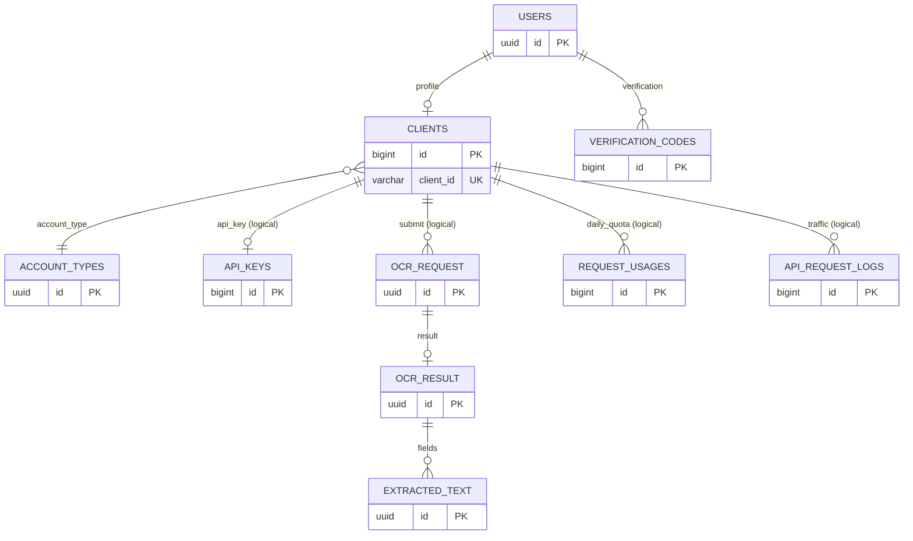
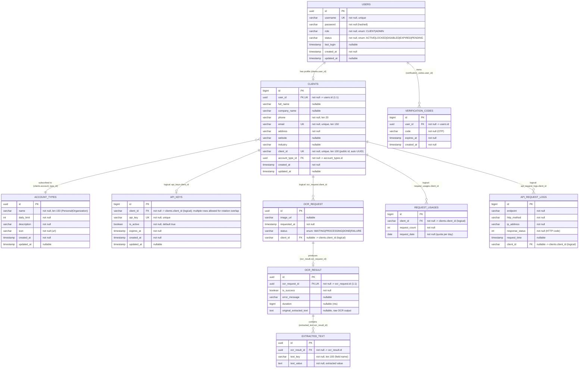
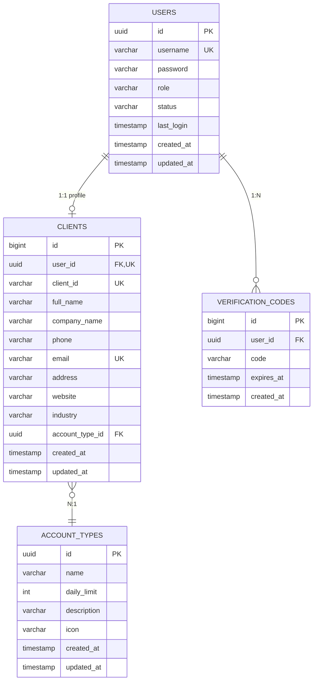
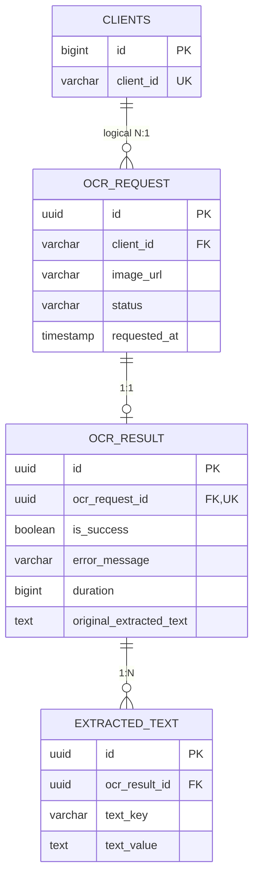
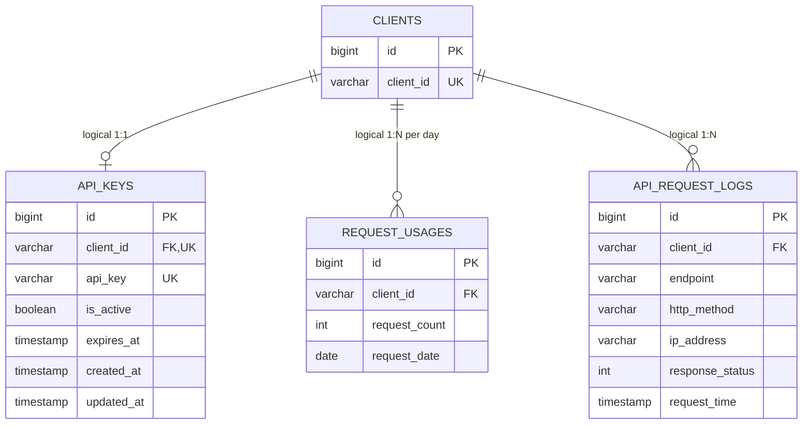
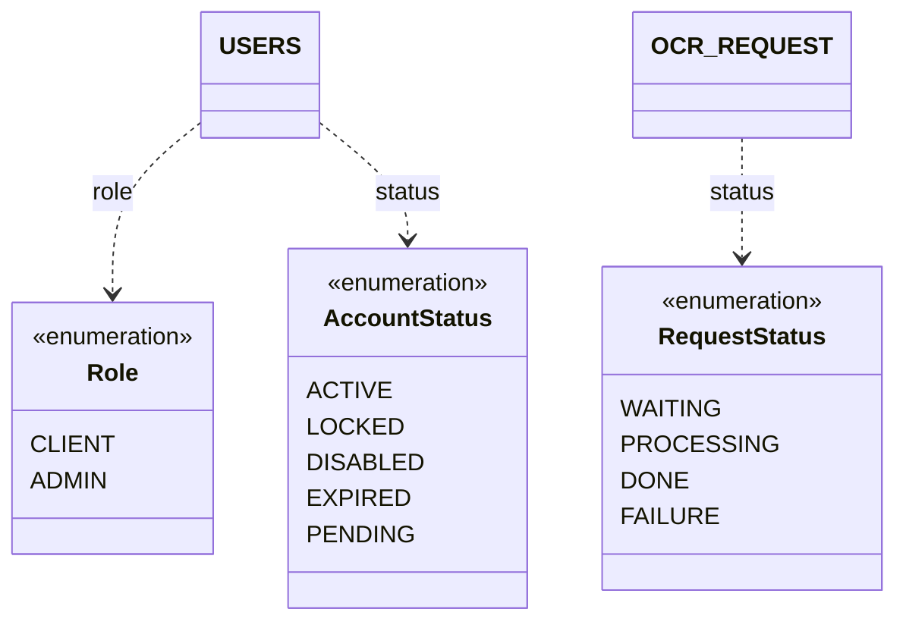

# Database Schema & Relations — OCR Tool

> Dokumen ini mengekstrak schema database dari source of truth JPA entity di `src/main/java/m2codes/ocr_tool/domain/model/`.
> Semua diagram memakai **Mermaid**, jadi bisa langsung dirender/dijadikan gambar oleh AI atau tool Mermaid.

| Item | Nilai |
|---|---|
| Project | ocr-tool (nestara-vision-saas) |
| Database | MySQL / MariaDB (`jdbc:mysql://.../ocr_tool`) |
| Schema management | Flyway migrations (`V1__baseline_schema.sql` sampai `V5__align_api_key_hash_schema.sql`) dengan baseline version 1; default `ddl-auto=validate` |

## API key pepper dan migrasi legacy

`APP_API_KEY_PEPPER` wajib diisi, minimal 32 karakter, dan harus stabil antar-deploy. Nilai ini
dipakai HMAC untuk `api_keys.key_hash`; jangan generate ulang saat container restart atau release.

Migrasi `V3__api_key_hash.sql` menambah kolom hash untuk transisi dari key legacy. Migration memakai
`ALTER TABLE` standar tanpa idempotency palsu; Flyway menjalankannya sekali pada database fresh atau
database yang sudah dibaseline di versi 1. Jika deployment lama gagal di V3, lakukan `flyway repair`
setelah memastikan kolom belum ada, lalu jalankan migrate ulang. Sebelum rotasi
pepper, migrasikan/reissue atau revoke seluruh key legacy dan verifikasi client memakai key baru.
Pertahankan pepper lama sampai proses selesai; rotasi tanpa dual-read/migrasi terencana membuat
key tersimpan tidak dapat diverifikasi.

`V1__baseline_schema.sql` adalah schema **legacy** (sebelum V2..V5) untuk instalasi baru:

| Kondisi database saat start | Perilaku Flyway |
|---|---|
| Kosong | V1 dijalankan, lalu V2..V5 (instalasi baru jalan tanpa langkah manual) |
| Sudah berisi schema legacy, belum ada `flyway_schema_history` | dibaseline di versi 1 (V1 dilewati), lalu V2..V5 |
| Sudah punya `flyway_schema_history` (deployment existing) | V1 dianggap di bawah baseline dan diabaikan; `validate` tetap lolos |

Konsekuensinya `docker compose up` pada volume database baru tidak perlu lagi membuat schema manual.
Kalau entity berubah, tambahkan migration baru — jangan mengedit `V1`, karena file itu sudah
diterapkan di instalasi baru.

| Tabel | 10 tabel |
| Tipe PK | `UUID` (logical) + `BIGINT AUTO_INCREMENT` (teknis/log) |
| Relasi | 4 relasi JPA (FK constraint) + 4 relasi logis (string `client_id`, tanpa FK constraint) |

---

## 1. High-Level View (per domain)

Cocok untuk gambar sederhana / slide. Dibagi 3 klaster: **Auth & Account**, **OCR Pipeline**, **Usage & Audit**.

---

## 2. Full ER Diagram (lengkap dengan kolom)

Gunakan ini sebagai acuan utama saat generate gambar. Relasi solid (`--`) = FK constraint nyata. Relasi `..` tidak dipakai karena mermaid ER hanya punya satu gaya garis; **relasi logis ditandai di label**.

---

## 3. Diagram Per Klaster (rekomendasi untuk gambar)

Tiga gambar terpisah lebih terbaca daripada satu diagram 10 tabel yang padat.

### 3.1 Auth & Account

### 3.2 OCR Pipeline

### 3.3 API Key, Quota & Audit Log

---

## 4. Relasi & Kardinalitas

| # | Parent | Child | Kolom | Kardinalitas | Enforcement |
|---|---|---|---|---|---|
| 1 | `users` | `clients` | `clients.user_id` | 1 : 0..1 | FK constraint + UNIQUE (dari `@OneToOne`) |
| 2 | `account_types` | `clients` | `clients.account_type_id` | 1 : N | FK constraint (`@ManyToOne`) |
| 3 | `users` | `verification_codes` | `verification_codes.user_id` | 1 : N | FK constraint (`@ManyToOne`) |
| 4 | `ocr_request` | `ocr_result` | `ocr_result.ocr_request_id` | 1 : 0..1 | FK constraint + UNIQUE (`@OneToOne`) |
| 5 | `ocr_result` | `extracted_text` | `extracted_text.ocr_result_id` | 1 : N | FK constraint (`@ManyToOne`) |
| 6 | `clients` | `api_keys` | `api_keys.client_id` | 1 : N | **Logis** (string match ke `clients.client_id`, tanpa FK) |
| 7 | `clients` | `ocr_request` | `ocr_request.client_id` | 1 : N | **Logis** |
| 8 | `clients` | `request_usages` | `request_usages.client_id` | 1 : N | **Logis** |
| 9 | `clients` | `api_request_logs` | `api_request_logs.client_id` | 1 : N | **Logis** |

### Kenapa ada relasi logis?

`clients` punya dua identitas: `id` (BIGINT, internal) dan `client_id` (VARCHAR(100), UUID publik yang dipakai di API layer). Tabel transaksi (`ocr_request`, `api_keys`, `request_usages`, `api_request_logs`) menyimpan **`client_id` publik**, bukan `clients.id`.

Konsekuensi untuk gambar diagram: bila AI menggambar, relasi 6–9 sebaiknya digambar **garis putus-putus** ke `clients.client_id`, bukan ke PK — supaya akurat.

---

## 5. Daftar Tabel & PK

| Tabel | Entity | PK | Strategi | Fungsi |
|---|---|---|---|---|
| `users` | `User` | `id` UUID | `GenerationType.AUTO` | Akun login (admin & client) |
| `clients` | `Client` | `id` BIGINT | `IDENTITY` | Profil customer + `client_id` publik |
| `account_types` | `AccountType` | `id` UUID | `AUTO` | Paket akun + `daily_limit` |
| `verification_codes` | `VerificationCode` | `id` BIGINT | `IDENTITY` | OTP / verifikasi email |
| `api_keys` | `ApiKey` | `id` BIGINT | `IDENTITY` | API key per client + expiry |
| `ocr_request` | `OcrRequest` | `id` UUID | `AUTO` | Satu submission OCR |
| `ocr_result` | `OcrResult` | `id` UUID | `AUTO` | Hasil/status satu request |
| `extracted_text` | `ExtractedText` | `id` UUID | `AUTO` | Field hasil ekstraksi (key-value) |
| `request_usages` | `RequestUsage` | `id` BIGINT | `IDENTITY` | Counter kuota harian |
| `api_request_logs` | `ApiRequestLog` | `id` BIGINT | `IDENTITY` | Audit trafik API |

Tidak ada tabel join many-to-many — semua relasi N:N potensial diselesaikan lewat kolom `client_id` atau agregasi ke `request_usages`.

---

## 6. Enum Values

| Enum | Kolom | Nilai | Penyimpanan |
|---|---|---|---|
| `Role` | `users.role` | `CLIENT`, `ADMIN` | `@Enumerated(STRING)` → VARCHAR |
| `AccountStatus` | `users.status` | `ACTIVE`, `LOCKED`, `DISABLED`, `EXPIRED`, `PENDING` | VARCHAR |
| `RequestStatus` | `ocr_request.status` | `WAITING`, `PROCESSING`, `DONE`, `FAILURE` | VARCHAR |

Status akun tidak dipakai di `clients` — status hidup di `users.status`, karena 1 user = 1 client.

---

## 7. Constraint Penting

| Tabel | Constraint | Alasan bisnis |
|---|---|---|
| `users` | `username` UNIQUE | Login identifier |
| `clients` | `email` UNIQUE | 1 email = 1 akun |
| `clients` | `client_id` UNIQUE | Public identifier untuk API |
| `clients` | `user_id` UNIQUE | 1 user hanya boleh punya 1 profil client |
| `api_keys` | `client_id` indexed | 1 client = banyak API key aktif selama overlap rotasi |
| `api_keys` | `api_key` UNIQUE | Key harus unik globally |
| `ocr_result` | `ocr_request_id` UNIQUE | 1 request = 1 result |

Tidak ada `@Index` eksplisit di entity. Index hanya berasal dari PK dan UNIQUE constraint. Query berat (`api_request_logs` by `client_id` + `request_time`, `request_usages` by `client_id` + `request_date`) berjalan tanpa index tambahan — lihat catatan di bawah.

---

## 8. Catatan & Risiko Schema

Temuan saat ekstraksi, relevan kalau schema mau dirapikan:

1. **Migration memakai Flyway dengan baseline version 1.** `V1__baseline_schema.sql` menyediakan schema legacy untuk database kosong; V2..V5 adalah delta di atasnya. Database existing yang sudah punya `flyway_schema_history` melewati V1 (di bawah baseline). API key baru disimpan hash-only melalui `api_keys.key_hash`; token plaintext lama tidak kompatibel dengan flow baru dan perlu rotasi.
2. **Relasi logis tanpa FK** (`client_id` string). Integritas data bergantung kode aplikasi. Kalau `clients.client_id` berubah (regenerate), baris historis jadi orphan. Opsi: ganti jadi `clients.id` BIGINT FK, atau tambah FK ke `clients(client_id)`.
3. **Index hilang di tabel log.** `api_request_logs` dan `request_usages` dipakai untuk reporting agregat; minimal butuh composite index (`client_id`, `request_time`) dan (`client_id`, `request_date`).
4. **`request_usages.request_date` bertipe `DATE` tapi field `Instant`** dan selalu ditimpa `Instant.now()` di `@PrePersist` — tidak bisa menyimpan tanggal historis hasil backfill, dan perbandingan `findByClientIdAndRequestDate(Instant)` rawan mismatch presisi. Bersihkan ke `LocalDate`.
5. **Duplikasi status.** `ocr_request.status` dan `ocr_result.is_success` menyimpan informasi yang saling tumpang tindih; perlu aturan tunggal mana yang jadi source of truth.
6. **`ocr_result` 1:1 dengan `ocr_request`** memaksa satu hasil per request. Kalau nanti butuh retry/ensemble multi-pass, constraint UNIQUE ini harus dilepas.
7. **`api_keys.api_key` adalah kolom legacy nullable.** Flow baru menyimpan hash-only di `key_hash`; V5 memastikan `api_key` nullable, `key_hash` unik, dan `client_id` punya index nonunique. Key lama perlu dirotasi sebelum kolom legacy dihapus.
8. **Tidak ada soft delete / audit actor.** `created_at`/`updated_at` ada, tapi tidak ada `deleted_at` maupun `updated_by`.
9. **Kuota harian tanpa unique constraint.** `request_usages` tidak punya UNIQUE (`client_id`, `request_date`), jadi dua request paralel bisa membuat dua baris counter untuk client + tanggal yang sama → kuota bocor. Tambahkan unique constraint + logika upsert atomik.

---

## 9. Prompt Saran untuk Generate Gambar

Kalau diagram ini mau dijadikan gambar oleh AI, pakai prompt seperti ini:

> Render the Mermaid `erDiagram` below as a clean, professional database schema diagram. Style: white background, flat design, 3 color-coded domain clusters — blue for Auth & Account (users, clients, account_types, verification_codes), green for OCR Pipeline (ocr_request, ocr_result, extracted_text), amber for Usage & Audit (api_keys, request_usages, api_request_logs). Each table as a rounded rectangle with header (table name) and rows for columns; mark PK with a key icon, FK with an arrow, UK with a "#". Draw solid lines for FK-constrained relations and dashed lines for logical relations (client_id). Label every edge with its cardinality (1:1, 1:N). No gradients, no 3D, readable at 1920px width, monospace column types.

Sumber: `docs/database-schema.md` (dokumen ini).
